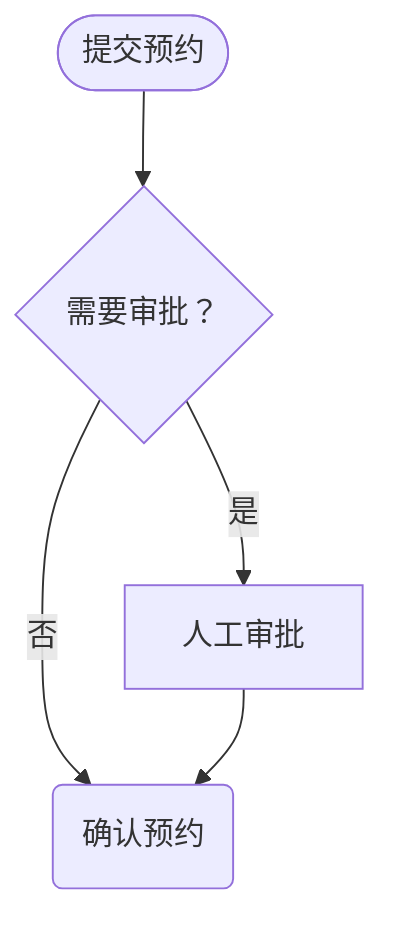
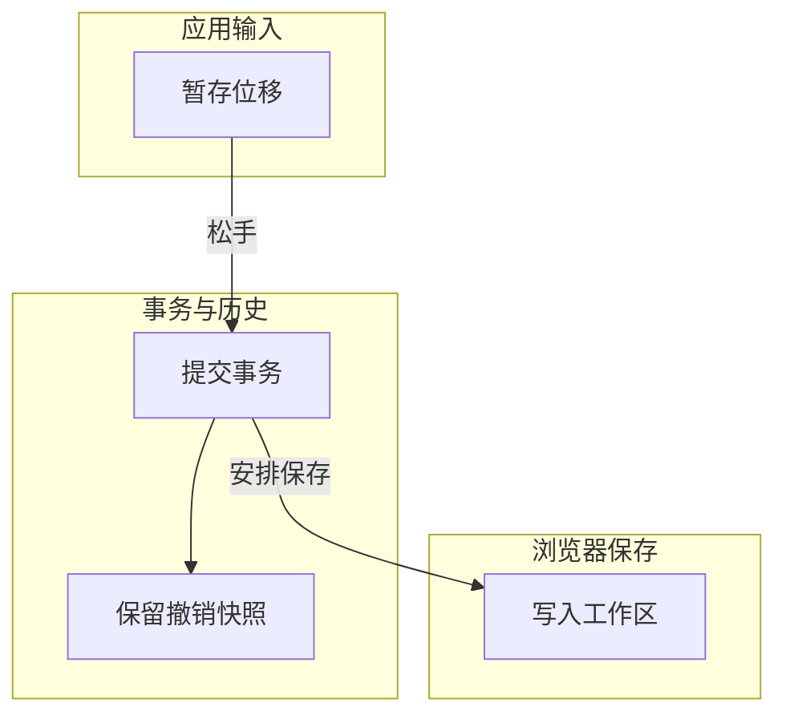

# 用 AI 创建可编辑流程图

`canvas_draw_flow` 接受一张紧凑图或一段 Mermaid 源码。每个节点成为可编辑的流程形状，每条边绑定两端的原生端口。一次调用对应一次撤销。

## 紧凑图

```json
{
  "baseRevision": "<canvas_read 返回的版本>",
  "operationId": "booking-flow-1",
  "graph": {
    "direction": "TD",
    "nodes": [
      {"id": "request", "label": "提交预约", "shape": "rounded"},
      {"id": "approval", "label": "需要审批？", "shape": "diamond"},
      {"id": "review", "label": "人工审批"},
      {"id": "book", "label": "确认预约", "shape": "stadium"}
    ],
    "edges": [
      {"from": "request", "to": "approval"},
      {"id": "needs-review", "from": "approval", "to": "review", "label": "是"},
      {"id": "direct-book", "from": "approval", "to": "book", "label": "否"},
      {"from": "review", "to": "book"}
    ]
  }
}
```

`direction` 支持 `TD`、`TB`、`BT`、`LR`、`RL`，默认自上而下。节点 `shape` 支持 `rect`、`rounded`、`stadium`、`circle`、`diamond`、`triangle`，默认矩形。边可指定 `arrow` 为 `end`、`none` 或 `both`。未命名的边按两端 ID 生成稳定 ID。显式 ID 需要在当前画板中可用。节点与边合计最多 1000 个。

可选的 `origin: {"x": 120, "y": 80}` 控制整张新图左上角的世界坐标，包含回边的外侧走线。应用会为省略原点的图选择画板上的位置。查看调用返回的 `nodeIdMap`、`edgeIdMap`，随后用一组 `canvas_edit` 的 `update` 操作即可按 ID 改一个节点或一条边。

## Mermaid 输入

在同一请求里用 `mermaid` 字符串代替 `graph`。下面的 `approved` 是可以在返回映射中查找的边 ID。



| 类别 | 可解析的写法 |
| --- | --- |
| 声明 | `flowchart` 或 `graph`，后接上述五种方向。支持换行、分号、`%%` 注释和单个 Mermaid 代码围栏。 |
| 节点 | `A`、`A[矩形]`、`A(圆角)`、`A([胶囊])`、`A((圆))`、`A{判断}`。引用会建立节点，重复声明采用最后一次明确指定的标签和形状。 |
| 标签 | 支持中文、双引号、引号内的分号和括号，以及 `<br/>` 换行。原生标签上限为 160 个 UTF-16 单元。菱形和边显示一行，其余节点至多三行。 |
| 分区 | `subgraph id[中文标题]` 和 `end` 包围成员声明。`subgraph id` 使用 ID 作标题。支持多个并列分区，跨区连线使用实际节点 ID。 |
| 连线 | `A --> B`、`A --- B`、`A <--> B`、`A -->\|文字\| B`、`A -- 文字 --> B`、`A edge1@--> B`。支持链式连接、`&` 并列端点、汇合、回环、自环和孤立节点。 |

Mermaid 节点标识使用 ASCII 字母或数字开头，后续可用字母、数字、下划线及连接相邻标识字符的点和短横线。中文名称写在标签里。每次导入的 Mermaid 标识在该图内有效，工具返回它与实际画板 ID 的映射。

遇到嵌套分区、分区内单独设置方向、类和样式、点击指令、扩展形状、虚线或粗线、HTML 富文本等未实现的语法，整次请求返回 `INVALID` 和源码行列，从 1 起算。紧凑图的错误指向字段路径，例如 `graph.edges[1].to`。[Mermaid 流程图语法](https://mermaid.js.org/syntax/flowchart.html)

## 分区与后续编辑



紧凑图使用可选的 `groups: [{id, label?, nodeIds}]` 表达同一归属。每个分区至少包含一个流程节点，每个节点只归属一个分区。标题是可编辑的原生形状，随成员一起移动。返回的 `groups` 给出每组的实际 `id`、`titleId` 和流程节点 `nodeIds`。改标题时用 `canvas_edit` 更新 `titleId` 的 `label`，并附上对应的 `group`。跨组连线可以用自己的 ID 单独修改。

纯函数位于 `features/flow-drawing.ts`。调用 `compileFlowDrawing({graph, origin?})` 或 `compileFlowDrawing({mermaid, origin?})` 得到 `{operations, nodeIds, edgeIds, groups}`。每个分区会占用一个标题形状，所有分区共用一条成员表操作。调用方将新旧成员表合并后，与所有创建操作一同传给 `executeBatch`。
